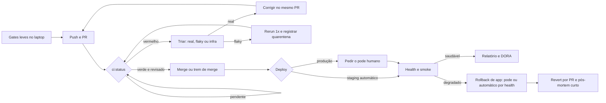

# Proposta: skill `cx-deploy-pipeline`

Fase 1 (pesquisa e arquitetura). Nada da skill foi criado ainda: este documento existe para o dono aprovar ou ajustar antes da escrita.

**Em uma frase:** a skill ensina o agente a levar uma mudança de **PR → CI → revisão → merge → deploy → verificação → rollback** com segurança, falando sempre com o **GitHub como fonte da verdade** e com o provedor (CircleCI, Actions, Dokploy, Railway…) só por um **adaptador** declarado no repositório do projeto.

## 1. Referências encontradas

### Skills

| Nome | Origem | O que espelhar | O que evitar |
|---|---|---|---|
| `gh-fix-ci` | [openai/skills](https://skills.sh/openai/skills/gh-fix-ci) | Script único que lê os checks do PR e extrai o trecho do log; plano aprovado antes de corrigir; `gh auth status` como pré-requisito | Escopo só de GitHub Actions: checks externos viram "só a URL" |
| `diagnose-ci-failures` | [warpdotdev/common-skills](https://skills.sh/warpdotdev/common-skills/diagnose-ci-failures) | Espera o CI terminar antes de diagnosticar; a saída é um plano, não código; `GH_PAGER=cat` | `gh run view --log-failed` amarra a Actions |
| `debug-ci-failures` | [CircleCI-Public/skills](https://github.com/CircleCI-Public/skills) | Ordem status → logs → flaky → testes que falharam, com filtro só de falhas | Para quando o MCP não está instalado; aqui o MCP é atalho, não requisito |
| `circleci-cli` | [CircleCI-Public/skills](https://skills.sh/circleci-public/skills/circleci-cli) | Validar a config antes do commit; token só por variável de ambiente | Comandos do provedor no corpo da skill (vão para o adaptador) |
| `circleci-deploy-setup` | [CircleCI-Public/skills](https://github.com/CircleCI-Public/skills) | Auditar o que já existe antes de gerar; "arquivos de tópico" por passo; rollback como pipeline registrado, não só arquivo | Acoplamento a marcadores e pipelines do CircleCI |
| `mcp-server-circleci` | [CircleCI-Public/mcp-server-circleci](https://github.com/CircleCI-Public/mcp-server-circleci) | Ferramentas `find_flaky_tests`, `rerun_workflow`, `run_rollback_pipeline`, validação de config: mapear como implementação opcional do contrato | Servidor remoto sem `REQUIRE_REQUEST_TOKEN` |
| `land-and-deploy` | gstack (local, `~/.claude/skills`) | Primeira execução em ensaio (dry-run); portão de prontidão antes do merge; profundidade do canário pelo escopo do diff; revert por PR quando a branch é protegida | 1.900 linhas, preâmbulo pesado, telemetria; nada disso cabe aqui |
| `canary` | gstack (local) | Alertar mudança contra a linha de base, não valor absoluto; só alertar após 2 checagens seguidas | Laço longo de navegador como padrão |
| `setup-deploy` | gstack (local) | Configuração de deploy declarada uma vez e relida (plataforma, URL, health, comando de status) | Gravar no `CLAUDE.md`; aqui vai para um arquivo do adaptador |
| `babysit` | poteto (local, `.agents/skills`) | Ordem conflito → CI → comentários; parar após 3 rodadas; nunca tirar um check de "obrigatório" | Amarrado ao poteto-mode |
| `shipping-and-launch` | [addyosmani/agent-skills](https://skills.sh/addyosmani/agent-skills/shipping-and-launch) | Tabela de limiares avançar / segurar / voltar; plano de rollback com seção de banco; "racionalizações comuns" | Checklist genérico longo |
| `use-railway` | local (`~/.claude/skills`) | `references/` por tarefa e `scripts/` próprios | `description` gigante com "mesmo sem dizer Railway" |
| `dokploy-self-hosted` | local | Gate de validação antes de criar serviço | Específico de uma VPS e de um fluxo pessoal |

### Boas práticas (fontes)

| Tema | Fonte | O que entra na skill |
|---|---|---|
| Checks obrigatórios e merge queue | [GitHub: managing a merge queue](https://docs.github.com/repositories/configuring-branches-and-merges-in-your-repository/configuring-pull-request-merges/managing-a-merge-queue), [troubleshooting required checks](https://docs.github.com/en/pull-requests/how-tos/merge-and-close-pull-requests/troubleshooting-required-status-checks) | Check exigido que não roda no evento da fila trava o merge; o nome do job, não o do arquivo, é o que se exige |
| `gh pr checks` | [cli.github.com/manual/gh_pr_checks](https://cli.github.com/manual/gh_pr_checks) (via ctx7) | Campo `bucket` (`pass`, `fail`, `pending`, `skipping`, `cancel`), `--required`, código de saída 8 = pendente |
| Flaky e quarentena | [minware: flaky test quarantine](https://www.minware.com/guide/best-practices/flaky-test-quarantine), [Mill: flaky tests](https://mill-build.org/blog/4-flaky-tests.html) | Quarentena tira do bloqueio, não da execução; dono e prazo; nunca virar cemitério |
| Health check e rollback | [Dokploy: rollbacks](https://docs.dokploy.com/docs/core/applications/rollbacks), [going production](https://docs.dokploy.com/docs/core/applications/going-production) | `FailureAction: rollback`, `start-first`; o rollback automático só cobre falha de health check |
| Canário e smoke | gstack `canary` e `shipping-and-launch` | Smoke curto logo após o deploy; canário opcional, comparado à linha de base |
| DORA, leve | [dora.dev/guides/dora-metrics](https://dora.dev/guides/dora-metrics/) | Só 4 números por mês, tirados do GitHub e do log de deploy; sem painel |

## 2. Arquitetura

### Árvore proposta

```text
skills/cx-deploy-pipeline/
  SKILL.md                     regras de ouro, tabela "Como trabalhar", onde achar o adaptador
  workflows/
    00-preparar-pr.md          01-ler-e-triar-ci.md      02-corrigir-ci-vermelho.md
    03-tratar-flaky.md         04-mesclar-com-seguranca.md
    05-deploy-com-pode.md      06-verificar-pos-deploy.md
    07-rollback.md             08-trocar-de-provedor.md  09-disco-e-recursos.md
  references/
    sintomas.md                "check amarelo há 1 h", "passa local e falha no CI"… → item a abrir
    contrato-adaptador.md      o que todo adaptador expõe (seção 3)
    adaptador-modelo.md        modelo para copiar no projeto
    regras/INDEX.md            1 .md por regra: merge só verde, pode humano, segredo, piso de disco…
    padroes/INDEX.md           1 .md por padrão: camadas L0–L3, trem de merge, quarentena,
                               health check, smoke e canário, rollback × migração, DORA leve
    provedores/INDEX.md        ci/{github-actions,circleci,buildkite}.md
                               deploy/{dokploy,railway,vercel,fly}.md  (CLI, MCP, armadilhas)
    seguranca.md               segredos, runners, cron como root e symlink
    diagramas.md               ASCII por padrão, Mermaid só para fluxo e arquitetura
    fontes.md
  scripts/                     Node 18+ ou Bun, sem dependências, todos com --ajuda
    ci-status.mjs  preflight-disco.mjs  checar-config.mjs  checar-health.mjs  redigir.mjs
```

No projeto (não é outra skill): `docs/deploy/pipeline/README.md` (regras da casa) e `docs/deploy/pipeline/adaptador.json` (comandos), mais os atalhos no `package.json` (`ci:status`, `ci:logs`, `deploy:health`…).

### Fluxo (Mermaid)



### Camadas (ASCII)

```text
+---------------------------------------------------------------+
| Agente + skill cx-deploy-pipeline                             |
|   fala só em verbos: status, logs, rerun, deploy, health,     |
|   rollback. Nunca chama o provedor direto.                    |
+------------------------------+--------------------------------+
                               | lê
+------------------------------v--------------------------------+
| Contrato do projeto  (docs/deploy/pipeline/adaptador.json)    |
|   checks exigidos, ambientes, quem dá o pode, piso de disco,  |
|   o que é pesado demais para o laptop                         |
+---------------+----------------------------+------------------+
                | ci.*                       | deploy.*
+---------------v-----------+   +------------v------------------+
| Adaptador de CI           |   | Adaptador de deploy           |
| CircleCI | Actions | ...  |   | Dokploy | Railway | Vercel ...|
| CLI > MCP > API, nessa    |   | CLI > MCP > API > painel      |
| ordem, o que existir      |   | humano                        |
+---------------+-----------+   +------------+------------------+
                | publica checks             | lê o SHA da main
+---------------v----------------------------v------------------+
| GitHub = fonte da verdade: PR, revisão, checks exigidos,      |
| merge, tag e SHA implantado                                   |
+---------------------------------------------------------------+
```

Trocar de provedor = trocar um bloco do meio; o de cima e o de baixo não mudam.

## 3. Contrato do adaptador

Cada campo é um comando do projeto (preferível: um script do `package.json`) ou `null` quando o provedor não oferece. A skill nunca adivinha: campo ausente vira "peça ao humano".

| Campo | Entrada | Saída esperada | Obrigatório |
|---|---|---|---|
| `ci.provider` | - | nome do provedor | sim |
| `ci.requiredChecks` | - | lista de contextos exigidos no GitHub | sim |
| `ci.status` | `<pr>` | tabela check × estado × link; saída 0 verde, 1 falha, 8 pendente | sim |
| `ci.logs` | `<pr> [check]` | trecho do erro, já redigido, até ~200 linhas | sim |
| `ci.rerun` | `<pr> [--failed]` | id da nova execução | não |
| `ci.flaky` | - | testes instáveis conhecidos | não |
| `ci.validateConfig` | - | ok ou erros de sintaxe da config | não |
| `ci.mcp` / `ci.cli` | - | nomes do MCP e da CLI, quando instalados | não |
| `deploy.environments[]` | - | `name`, `trigger` (auto na main, tag, manual), `needsPode`, `healthUrls`, `smoke` | sim |
| `deploy.run` | `<env> [ref]` | id do deploy | só se não for automático |
| `deploy.status` | `<env>` | SHA implantado, estado, hora | sim |
| `deploy.logs` | `<env> [serviço]` | logs recentes, redigidos | sim |
| `deploy.rollback` | `<env> [versão]` | versão anterior no ar | sim |
| `deploy.migrations` | - | política: `expand-contract`, `forward-only` ou `down-permitido` | sim |
| `recursos.pisoDiscoGb` | - | número; abaixo dele o agente para | sim |
| `recursos.proibidoNoLaptop` | - | comandos pesados (suíte E2E, smoke com banco…) | sim |
| `segredos.onde` | - | "painel do provedor", "cofre"…; nunca o valor | sim |

### Exemplo preenchido: CircleCI + Dokploy

```json
{
  "ci": {
    "provider": "circleci",
    "requiredChecks": ["ci/circleci: gates", "ci/circleci: e2e-afetado"],
    "status": "bun run ci:status <pr>",
    "logs": "bun run ci:logs <pr> <check>",
    "rerun": "bun run ci:rerun <pr> --failed",
    "flaky": "mcp: find_flaky_tests",
    "validateConfig": "circleci config validate",
    "cli": "circleci", "mcp": "circleci-mcp-server"
  },
  "deploy": {
    "provider": "dokploy",
    "environments": [
      { "name": "staging", "trigger": "auto-main", "needsPode": false,
        "healthUrls": ["https://api.<staging>/health"], "smoke": "bun run deploy:smoke staging" },
      { "name": "production", "trigger": "tag v*", "needsPode": true,
        "healthUrls": ["https://api.<prod>/health"], "smoke": "bun run deploy:smoke production" }
    ],
    "status": "bun run deploy:status <env>",
    "logs": "dokploy (CLI) ou painel: aba Logs",
    "rollback": "painel do Dokploy: redeploy da versão anterior, ou revert por PR",
    "migrations": "expand-contract"
  },
  "recursos": { "pisoDiscoGb": 5, "proibidoNoLaptop": ["test:e2e", "smoke", "ci:local --tier train"] },
  "segredos": { "onde": "variáveis do projeto no CircleCI e aba Environment do Dokploy" }
}
```

## 4. Workflows propostos (10)

| # | Workflow | Uma linha |
|---|---|---|
| 00 | Preparar PR | Gates leves locais (tipos, lint, unitários, E2E só do arquivo tocado), `preflight-disco`, PR grande por história com "Antes → Depois" |
| 01 | Ler e triar o CI | `ci:status`; se pendente, esperar com intervalo; se vermelho, classificar em real, flaky ou infraestrutura |
| 02 | Corrigir CI vermelho | Um erro acionável por vez, no mesmo PR; 3 rodadas sem verde → parar e resumir ao humano |
| 03 | Tratar flaky | No máximo 1 rerun; se passar, registrar com dono e prazo; nunca relaxar asserção nem desligar o check |
| 04 | Mesclar com segurança | Só com todos os `requiredChecks` em `pass` no SHA final e revisão feita; lote ou trem quando houver |
| 05 | Deploy com o "pode" | Mostrar SHA, ambiente, migrações e plano de volta; esperar o "pode" quando `needsPode` |
| 06 | Verificar pós-deploy | SHA implantado confere, `checar-health`, smoke; profundidade pelo escopo do diff; canário opcional |
| 07 | Rollback | App primeiro (versão anterior ou revert por PR); migração só pela política declarada; registrar o incidente |
| 08 | Trocar de provedor | Preencher o novo adaptador, `checar-config`, rodar CI novo e antigo em paralelo num PR, trocar os checks exigidos por último |
| 09 | Disco e recursos | Abaixo do piso: parar o pesado, commit e push do WIP, limpar só o que é seguro, avisar |

## 5. Scripts propostos

| Script | Entrada | Saída | Por que existe |
|---|---|---|---|
| `ci-status.mjs` | `<pr>` (ou branch atual), `--required`, `--json` | Tabela check × estado × provedor (pelo host do link) × link; saída 0/1/8 como o `gh` | É o "comando único" de referência; o projeto pode apontar o `ci:status` para ele |
| `preflight-disco.mjs` | `--piso <GB>`, `--caminho` | Livre × piso; lista do que parar e o lembrete de commit e push; saída 1 abaixo do piso | O laptop do dono já ficou com ~1 GB; parar antes de corromper build ou repositório |
| `checar-config.mjs` | caminho do `adaptador.json` | Campos faltando, comandos que não existem no `package.json`, `requiredChecks` que o GitHub nunca viu, valores que parecem segredo | Impede adaptador quebrado e token colado por engano |
| `checar-health.mjs` | URLs ou o ambiente do adaptador, `--tentativas`, `--linha-de-base` | Status, latência, diferença contra a linha de base | Verificação pós-deploy igual em qualquer provedor |
| `redigir.mjs` | log pela entrada padrão | O mesmo log com tokens mascarados | Todo log passa por ele antes de ir para chat, PR ou relatório |

## 6. Gatilho

**`description` proposta:**

> Conduz uma mudança de PR até produção com segurança: lê os checks do PR, tria e corrige CI vermelho, trata testes instáveis, mescla só com check verde, faz deploy com o "pode" humano, verifica saúde e smoke depois e faz rollback quando preciso. Independe de provedor: CircleCI, GitHub Actions ou Buildkite no CI, e Dokploy, Railway, Vercel ou Fly no deploy, por um adaptador do projeto, com o GitHub como fonte da verdade. Use sempre que o pedido envolver status de CI, "por que o CI falhou", checks do PR, flaky, rerun, merge, trem de merge, deploy, staging, produção, health check, smoke, canário, rollback, revert, troca de provedor de CI ou deploy, falta de disco durante build ou teste, ou quando for rodar uma suíte pesada no laptop. Use mesmo que o provedor não seja citado.

| Deve disparar | Não deve disparar |
|---|---|
| "O CI do PR 120 está vermelho, vê o que é" | "Escreve um teste unitário para esta função" |
| "Pode mesclar o 118?" | "Cria um `.circleci/config.yml` do zero para um projeto Go" (configuração, não fluxo) |
| "Sobe para staging e confere se está de pé" | "Explica o que é Docker Swarm" |
| "Esse teste falha às vezes no CircleCI" | "Faz o commit desta mudança" |
| "Deu ruim em produção, volta a versão" | |
| "Quero sair do CircleCI e ir para o Buildkite" | |

## 7. Riscos e anti-padrões

| Anti-padrão | Regra da skill |
|---|---|
| Mesclar com check amarelo ou "quase tudo verde" | Merge só com todos os exigidos em `pass` no SHA final |
| Rodar a suíte completa, smoke com banco ou `ci:local` inteiro no laptop | Laptop só roda gates leves; o resto é do CI (`proibidoNoLaptop`) |
| Imprimir, digitar ou colar segredo | O humano cola no painel ou em prompt seguro; logs passam por `redigir` |
| Deploy sem health check ou sem conferir o SHA implantado | O deploy só termina depois de `deploy.status` e `checar-health` |
| Rollback de app que não desfaz migração | Política declarada; padrão expand-contract (migração compatível com a versão anterior) |
| Rerun em série até passar | 1 rerun; o segundo vermelho é falha real |
| Tirar um check de "obrigatório" para destravar | Proibido; só o humano muda a proteção da branch |
| Quarentena eterna | Todo flaky tem dono e prazo |
| Runner self-hosted com cron como root apagando caminho controlado pelo usuário do runner | Ninguém como root apaga ou escreve em caminho de usuário sem resolver o link (`realpath`, `--no-dereference`, `find -xdev`); jobs de limpeza rodam com o mesmo usuário do runner (escalada por symlink) |
| Forks rodando com segredo | Nunca liberar segredos para PR de fork |
| Agente decidindo produção | `needsPode: true` exige o "pode" do humano a cada deploy, sem generalizar |

## 8. Perguntas para o dono

1. **Onde fica o adaptador no projeto?**
   - **(Recomendado)** `docs/deploy/pipeline/README.md` + `adaptador.json` (validável por script);
   - só uma seção no `AGENTS.md`;
   - um arquivo na raiz (`.cx/pipeline.json`).
2. **Quais provedores entram com página própria na v1?**
   - **(Recomendado)** CircleCI, GitHub Actions e Dokploy (o que já usamos), os demais como esboço de uma tela;
   - também Railway, Vercel e Fly completos;
   - só o contrato, sem páginas por provedor.
3. **Como fica o comando único `ci:status`?**
   - **(Recomendado)** o projeto expõe `ci:status`, que chama o `ci-status.mjs` da skill e acrescenta o que for do provedor;
   - a skill chama `gh` direto e ignora o projeto;
   - cada projeto escreve o seu do zero.
4. **Trem de merge ou merge queue do GitHub?**
   - **(Recomendado)** a skill ensina os dois e o adaptador escolhe; no PrivateLab segue o trem (`train/*`), porque a merge queue não está disponível no plano atual;
   - só merge queue;
   - merge PR a PR, sem lote.
5. **Rollback com migração de banco:**
   - **(Recomendado)** expand-contract obrigatório e rollback só de app; restaurar backup só com "pode";
   - permitir migração de descida com "pode";
   - forward-only, corrigindo sempre para frente.
6. **DORA entra na v1?**
   - **(Recomendado)** sim, leve: 4 números no relatório mensal, tirados do GitHub e do log de deploy;
   - fica para a v2;
   - não entra.
