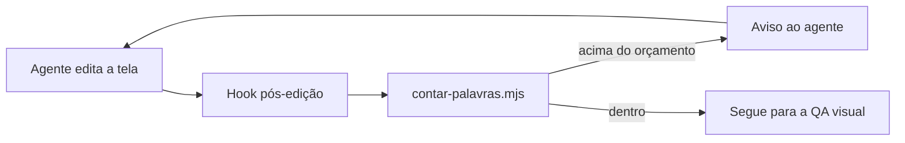
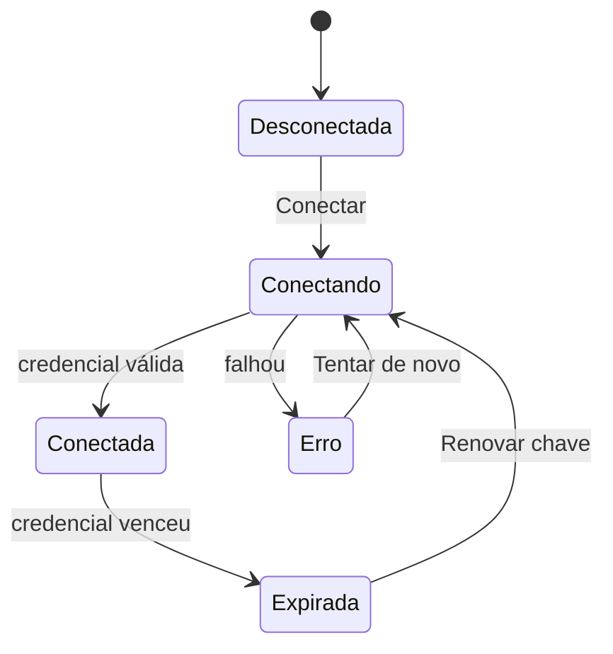

# Diagramas: ASCII ou Mermaid

Critério único: **o diagrama tem de mostrar algo que o texto não mostra.** Se uma lista de 3 itens diz o mesmo, escreva a lista.

## ASCII é o padrão

Use ASCII para tudo que é tela ou decisão:

- wireframes (convenção em [`wireframe-ascii.md`](wireframe-ascii.md));
- fluxos de tela (de onde a pessoa vem, para onde vai);
- antes e depois;
- árvores de decisão.

Por quê: cabe num PR, num chat e num diff, não depende de renderizador e obriga a decidir estrutura antes de estilo.

Fluxo de tela:

```text
[Lista de faturas] --clique na linha--> [Sheet da fatura]
        |                                   |
   [■ Emitir fatura]                  [■ Reenviar]
        v                                   v
[Formulário em passos] --salvar--> [Lista] + aviso "Fatura emitida · Desfazer"
```

Árvore de decisão (para onde vai um texto):

```text
O texto muda a decisão?
├── sim → fica visível (selo, número, 1 linha)
└── não → só explica?
          ├── sim → ⓘ tooltip ou popover
          └── não → repete o título ou o vizinho → corta
```

## Mermaid, raramente

Use Mermaid só para arquitetura ou fluxo de dados, quando há muitas setas, estados ou atores e o ASCII ficaria ilegível. Nunca para wireframe.

Fluxo de dados (hook → lint → agente):



Estados de uma integração:



O segundo diagrama paga o próprio custo: mostra de uma vez todos os estados e a ação que tira de cada um, o que vira o mapa de selos (`(● Expirada)`) e de botões (`[■ Renovar chave]`) da tela.

## Checklist rápido

| Pergunta | Se sim |
|---|---|
| É uma tela ou parte de uma tela? | ASCII |
| É uma escolha entre caminhos? | ASCII (árvore) |
| Tem mais de 5 estados ou 3 atores trocando dados? | Mermaid |
| Uma lista ou tabela diz o mesmo? | Sem diagrama |
