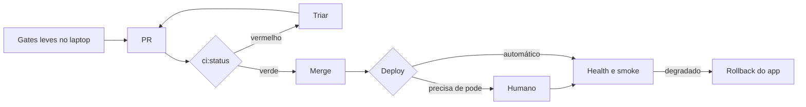

# Diagramas: ASCII ou Mermaid

Critério único: o diagrama tem de mostrar algo que uma lista não mostra.

## ASCII é o padrão

Para estado de checks, árvores de decisão e resumos que vão para chat, PR ou terminal:

```text
O check falhou?
├── erro antes dos testes (install, token, cota) → infraestrutura → página do provedor
└── erro num teste
    ├── passou no rerun → flaky → 03
    └── falhou de novo  → real  → 02
```

Camadas (o agente nunca pula uma):

```text
agente → contrato do projeto (.cx/pipeline) → adaptador do provedor → GitHub (fonte da verdade)
```

## Mermaid, raramente

Só para fluxo com muitos ramos ou arquitetura com vários atores, num documento que renderiza Mermaid:



| Pergunta | Se sim |
|---|---|
| Vai para chat, PR ou terminal? | ASCII |
| É uma escolha entre caminhos? | ASCII (árvore) |
| Tem mais de 5 estados ou 3 atores trocando dados? | Mermaid |
| Uma tabela diz o mesmo? | Sem diagrama |
